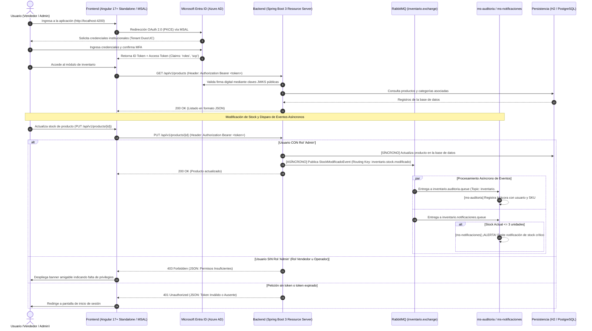

# Sistema de Gestión de Inventario para Locales Comerciales (Cloud Native)
### Arquitectura SPA + Resource Server protegida por Microsoft Entra ID (Azure AD) y Mensajería Asíncrona con RabbitMQ
**Asignatura**: Desarrollo Cloud Native I (DSY1107) • **Evaluación Parcial N° 1**

---

## 📑 Tabla de Contenidos
1. [Descripción General del Proyecto](#1-descripción-general-del-proyecto)
2. [Arquitectura del Sistema y Flujo de Autenticación](#2-arquitectura-del-sistema-y-flujo-de-autenticación)
3. [Estructura del Proyecto y Árbol de Directorios](#3-estructura-del-proyecto-y-árbol-de-directorios)
4. [Explicación Exhaustiva del Código: Backend (Spring Boot 3)](#4-explicación-exhaustiva-del-código-backend-spring-boot-3)
   - 4.1. Punto de Entrada Principal
   - 4.2. Módulo de Configuración y Seguridad (`config/`)
   - 4.3. Modelo de Dominio y Entidades JPA (`domain/`)
   - 4.4. Capa de Transferencia de Datos (`dto/`)
   - 4.5. Capa de Persistencia (`repository/`)
   - 4.6. Capa de Lógica de Negocio y Servicios (`service/`)
   - 4.7. Arquitectura Orientada a Eventos y Consumidores (`consumer/`)
   - 4.8. Controladores REST (`controller/`)
   - 4.9. Gestión Global de Errores y Excepciones (`exception/`)
   - 4.10. Parámetros de Configuración y Semilla SQL (`resources/`)
   - 4.11. Pruebas Automatizadas de Seguridad (`test/`)
5. [Explicación Exhaustiva del Código: Frontend (Angular 17+ Standalone)](#5-explicación-exhaustiva-del-código-frontend-angular-17-standalone)
   - 5.1. Inicialización y Configuración de MSAL (`app.config.ts` y Entornos)
   - 5.2. Enrutamiento y Protección de Rutas (`app.routes.ts` y `guards/`)
   - 5.3. Componente Raíz (`app.component.ts`)
   - 5.4. Capa de Modelos TypeScript (`models/`)
   - 5.5. Capa de Servicios Reactivos (`services/`)
   - 5.6. Componentes de Interfaz de Usuario (`components/`)
6. [Matriz de Roles y Permisos (RBAC)](#6-matriz-de-roles-y-permisos-rbac)
7. [Catálogo de Endpoints de la API REST](#7-catálogo-de-endpoints-de-la-api-rest)
8. [Guía de Instalación y Ejecución Local](#8-guía-de-instalación-y-ejecución-local)
9. [Guía de Pruebas de Seguridad y Códigos HTTP](#9-guía-de-pruebas-de-seguridad-y-códigos-http)

---

## 1. Descripción General del Proyecto

Este sistema es una solución empresarial diseñada bajo los principios de las arquitecturas **Cloud Native** para el control, supervisión y administración del inventario de locales comerciales, tiendas minoristas y terminales de punto de venta (POS).

### Principales Capacidades y Patrones de Diseño:
* **Desacoplamiento Total Frontend / Backend**: El frontend es una Single-Page Application (SPA) que consume servicios RESTful de forma asíncrona mediante HTTPS.
* **Seguridad Empresarial OAuth 2.0 / OpenID Connect**: Autenticación centralizada y federada mediante **Microsoft Entra ID (anteriormente Azure Active Directory)** utilizando el flujo **PKCE** (Proof Key for Code Exchange) para clientes públicos (SPA) y validación criptográfica en el Resource Server mediante endpoint JWKS (`NimbusJwtDecoder`).
* **Control de Acceso Basado en Roles (RBAC)**: Separación estricta de permisos entre usuarios con rol `Admin` (lectura, creación, modificación y eliminación) y usuarios con rol `User` / Vendedores (únicamente consulta).
* **Arquitectura Orientada a Eventos (EDA - Event-Driven Architecture)**: Integración con **RabbitMQ** para desacoplar operaciones críticas de inventario. Cuando se produce una variación en el stock de un producto, se emite un evento asíncrono que es procesado por colas especializadas de **Auditoría** y **Alertas de Stock Crítico**.
* **Persistencia Dual**: Soporte para base de datos en memoria **H2** en entornos de desarrollo local y driver **PostgreSQL** para instancias en la nube (ej. AWS RDS).

---

## 2. Arquitectura del Sistema y Flujo de Autenticación

El siguiente diagrama detalla la interacción entre el usuario, la aplicación web Angular, Microsoft Entra ID como Identity Provider (IdP), el backend Spring Boot como Resource Server, el Broker de mensajería RabbitMQ y la base de datos:



---

## 3. Estructura del Proyecto y Árbol de Directorios

```text
DSY1107-002D-Evaluacion/
│
├── README.md                                   # Documentación técnica integral del sistema
├── GUIA_PRUEBAS_POSTMAN.md                     # Manual detallado de pruebas con Postman
├── Retail_Inventory_API.postman_collection.json # Colección de endpoints lista para importar
│
├── backend/                                    # Proyecto Backend: Spring Boot 3 Resource Server
│   ├── pom.xml                                 # Dependencias Maven (Spring Web, Security, AMQP, Azure BOM)
│   ├── mvnw & mvnw.cmd                         # Maven Wrapper multiplataforma
│   └── src/
│       ├── main/
│       │   ├── java/com/retail/inventory/
│       │   │   ├── InventoryBackendApplication.java     # Clase ejecutable Spring Boot
│       │   │   │
│       │   │   ├── config/                              # Configuraciones centrales
│       │   │   │   ├── AzureJwtGrantedAuthoritiesConverter.java # Mapeo de claims a GrantedAuthorities
│       │   │   │   ├── CorsConfig.java                          # Filtro de cabeceras CORS
│       │   │   │   ├── RabbitMQConfig.java                      # Definición de Exchanges, Queues, DLQs y Bindings
│       │   │   │   ├── RabbitMQProperties.java                  # Mapeo @ConfigurationProperties (app.rabbitmq.*)
│       │   │   │   └── SecurityConfig.java                      # Cadena de filtros de seguridad y JwtDecoder
│       │   │   │
│       │   │   ├── consumer/                            # Consumidores de mensajería asíncrona por dominio
│       │   │   │   ├── AuditoriaConsumer.java                   # Listener de auditoría con ACK/NACK manual
│       │   │   │   └── NotificacionesConsumer.java              # Listener de notificaciones y stock crítico
│       │   │   │
│       │   │   ├── controller/                          # Controladores REST expuestos
│       │   │   │   ├── CategoryController.java                  # Endpoints /api/v1/categories
│       │   │   │   ├── ProductController.java                   # Endpoints /api/v1/products
│       │   │   │   └── RabbitAdminController.java               # Microservicio Administrador /api/v1/admin/rabbitmq
│       │   │   │
│       │   │   ├── domain/                              # Entidades de modelo de datos JPA
│       │   │   │   ├── Category.java                            # Tabla 'categories'
│       │   │   │   └── Product.java                             # Tabla 'products'
│       │   │   │
│       │   │   ├── dto/                                 # Data Transfer Objects
│       │   │   │   ├── CategoryRequestDto.java                  # Payload para crear/editar categorías
│       │   │   │   ├── CategoryResponseDto.java                 # Respuesta JSON de categorías
│       │   │   │   ├── ProductRequestDto.java                   # Payload validado con Bean Validation
│       │   │   │   ├── ProductResponseDto.java                  # Respuesta JSON de productos
│       │   │   │   ├── StockModificadoEvent.java                # Objeto de evento para RabbitMQ
│       │   │   │   ├── QueueRequestDto.java                     # Payload validado para crear colas dinámicas
│       │   │   │   ├── ExchangeRequestDto.java                  # Payload validado para crear exchanges
│       │   │   │   ├── BindingRequestDto.java                   # Payload validado para declarar bindings
│       │   │   │   └── ErrorResponseDto.java                    # Formato estandarizado de error (RFC-7807)
│       │   │   │
│       │   │   ├── exception/                           # Manejo de excepciones
│       │   │   │   ├── BadRequestException.java                 # Error 400 por reglas de negocio
│       │   │   │   ├── ResourceNotFoundException.java           # Error 404 para entidades inexistentes
│       │   │   │   ├── CustomAuthenticationEntryPoint.java      # Interceptor de seguridad 401
│       │   │   │   ├── CustomAccessDeniedHandler.java           # Interceptor de seguridad 403
│       │   │   │   └── GlobalExceptionHandler.java              # @RestControllerAdvice centralizado
│       │   │   │
│       │   │   ├── repository/                          # Repositorios Spring Data JPA
│       │   │   │   ├── CategoryRepository.java                  # Consultas sobre categorías
│       │   │   │   └── ProductRepository.java                   # Consultas y búsquedas JPQL de productos
│       │   │   │
│       │   │   └── service/                             # Capa de servicio y aislamiento
│       │   │       ├── CategoryService.java                     # Interfaz de servicio de categorías
│       │   │       ├── ProductService.java                      # Interfaz de servicio de productos
│       │   │       ├── InventoryEventPublisher.java             # Puerto desacoplado para eventos de dominio
│       │   │       ├── RabbitAdminService.java                  # Servicio de administración dinámica de RabbitMQ
│       │   │       └── impl/
│       │   │           ├── CategoryServiceImpl.java             # Implementación de reglas de categoría
│       │   │           ├── ProductServiceImpl.java              # Implementación de inventario desacoplada
│       │   │           ├── RabbitInventoryEventPublisherImpl.java # Implementación de mensajería AMQP
│       │   │           └── RabbitAdminServiceImpl.java          # Implementación de gestión dinámica AmqpAdmin
│       │   │
│       │   └── resources/
│       │       ├── application.yml                      # Configuración centralizada (app.rabbitmq.*, Azure, H2)
│       │       └── data.sql                             # Semilla inicial: 10 categorías y 25+ productos
│       │
│       └── test/java/com/retail/inventory/
│           ├── InventoryBackendApplicationTests.java        # Smoke test del contexto Spring
│           └── controller/
│               ├── ProductSecurityTest.java                 # Pruebas de seguridad de inventario (401, 403, 200)
│               └── RabbitAdminSecurityTest.java             # Pruebas de seguridad módulo RabbitMQ (401, 403, 201)
│
└── frontend/                                   # Proyecto Frontend: Angular 17+ Standalone SPA
    ├── package.json                            # Dependencias (@azure/msal-browser, @azure/msal-angular)
    ├── angular.json                            # Configuración del workspace y compilador esbuild
    ├── tsconfig.json                           # Reglas de tipado TypeScript
    └── src/
        ├── index.html                          # HTML base con fuentes Inter y JetBrains Mono
        ├── styles.css                          # Estilos globales, variables CSS y diseño responsive
        ├── environments/                       # Variables de entorno
        │   ├── environment.ts                  # Configuración de producción (AWS / IP elástica)
        │   └── environment.development.ts      # Configuración de desarrollo (localhost:4200 / 8080)
        └── app/
            ├── app.config.ts                   # Inyección de dependencias Standalone, MSAL e interceptores
            ├── app.routes.ts                   # Tabla de rutas y protección con authGuard
            ├── app.component.ts|html|css       # Shell principal y detector de redirecciones OAuth
            │
            ├── models/                         # Interfaces TypeScript
            │   ├── category.model.ts                   # Modelo Category y CategoryRequest
            │   ├── product.model.ts                    # Modelo Product y ProductRequest
            │   └── user-profile.model.ts               # Estructura del perfil y claims del usuario
            │
            ├── guards/                         # Guards de navegación
            │   └── auth.guard.ts                       # Control de acceso a rutas protegidas
            │
            ├── services/                       # Servicios Angular
            │   ├── auth.service.ts                     # Wrapper reactivo para MSAL (login, logout, claims)
            │   └── inventory.service.ts                # Consumo de API REST y manejo reactivo de errores
            │
            └── components/                     # Componentes visuales Standalone
                ├── alert/                              # Banner reactivo para alertas 401 y 403
                ├── categories/                         # Pantalla de gestión de categorías
                ├── inventory/                          # Dashboard principal con métricas y tabla
                ├── landing/                            # Portada pública de bienvenida
                ├── navbar/                             # Barra superior con estado de usuario y roles
                └── product-modal/                      # Formulario reactivo para alta y edición
```

---

## 4. Explicación Exhaustiva del Código: Backend (Spring Boot 3)

El backend está desarrollado sobre **Java 17** y **Spring Boot 3.3.3**, operando como un **Resource Server OAuth 2.0 Stateless**.

### 4.1. Punto de Entrada Principal
* **`InventoryBackendApplication.java`**:
  Anotado con `@SpringBootApplication`, inicia el contenedor de Spring Boot, inicializa el pooling de conexiones, las tablas JPA y el escaneo de componentes.

---

### 4.2. Módulo de Configuración y Seguridad (`config/`)

* **`SecurityConfig.java`**:
  Define la arquitectura de seguridad integral del servidor:
  * `@EnableWebSecurity` y `@EnableMethodSecurity(prePostEnabled = true)`: Habilita el control de acceso a nivel de método mediante anotaciones como `@PreAuthorize`.
  * `SecurityFilterChain`:
    * Configura la sesión en modo `SessionCreationPolicy.STATELESS` (sin sesiones HTTP en memoria ni JSESSIONID).
    * Deshabilita CSRF (`AbstractHttpConfigurer::disable`), dado que al usar Bearer Tokens en encabezados de autorización la aplicación no es vulnerable a ataques de falsificación de peticiones en sitios cruzados.
    * Habilita iframes con origen `sameOrigin` para permitir el acceso a la consola de base de datos H2 (`/h2-console`).
    * Configura reglas de autorización por URL:
      * Públicos: `/h2-console/**` y peticiones de sondeo previo `OPTIONS /**` (Preflight de CORS).
      * Lectura (`GET /api/v1/**`): Requiere únicamente estar autenticado (`authenticated()`).
      * Escritura y Eliminación (`POST`, `PUT`, `DELETE /api/v1/**`): Requiere explícitamente el rol `Admin` (`hasAnyAuthority("ROLE_Admin", "ROLE_ADMIN")`) o permisos delegados de Microsoft Entra ID.
  * `jwtDecoder()`: Configura el decodificador `NimbusJwtDecoder` conectándose dinámicamente al endpoint de llaves criptográficas públicas de Microsoft (`https://login.microsoftonline.com/common/discovery/v2.0/keys`). Incorpora un `DelegatingOAuth2TokenValidator` compuesto por:
    1. Validador de vigencia de tiempo (`JwtTimestampValidator`: `exp` y `nbf`).
    2. Validador de Emisor (`iss`): Verifica que provenga del tenant corporativo configurado en Microsoft Entra ID.
    3. Validador de Audiencia (`aud`): Valida que el token haya sido generado expresamente para el Client ID o App ID URI del Backend.
  * `corsConfigurationSource()`: Configura los orígenes autorizados (`http://localhost:4200`, IP de AWS), los métodos HTTP permitidos (`GET`, `POST`, `PUT`, `DELETE`, `OPTIONS`) y los encabezados permitidos (`Authorization`, `Content-Type`).

* **`AzureJwtGrantedAuthoritiesConverter.java`**:
  Implementa la interfaz `Converter<Jwt, Collection<GrantedAuthority>>`. Su función es traducir los claims contenidos en el JWT emitido por Microsoft Entra ID al modelo de seguridad de Spring Security:
  * Inspecciona el claim `roles` (App Roles asignados en Azure Portal). Para cada rol encontrado (ej. `"Admin"`), genera la autoridad con prefijo estándar de Spring: `ROLE_Admin`.
  * Inspecciona los claims `scp` o `scope` (Permisos delegados). Para cada scope (ej. `"user_impersonation"`), genera la autoridad con prefijo `SCOPE_user_impersonation`.
  * Soporta la propiedad `app.security.default-admin`: Si se encuentra activa en el entorno de desarrollo, inyecta privilegios administrativos por defecto para facilitar pruebas continuas.

* **`CorsConfig.java`**:
  Componente auxiliar que registra un `CorsFilter` asegurando máxima compatibilidad en peticiones HTTP cross-origin provenientes de navegadores web.

* **`RabbitMQProperties.java`**:
  Clase anotada con `@Configuration` y `@ConfigurationProperties(prefix = "app.rabbitmq")` que centraliza la totalidad de nombres de Exchanges, Colas, Colas Dead Letter (DLQ) y Routing Keys desde `application.yml`, eliminando cualquier cadena hardcodeada en las clases de negocio o consumidores.

* **`RabbitMQConfig.java`**:
  Declara la infraestructura completa de mensajería orientada a eventos con Spring AMQP:
  * **Exchanges**:
    * `TopicExchange` principal (`inventario.exchange`): Enrutamiento dinámico por temas (`inventario.#`, `inventario.stock.modificado`).
    * `DirectExchange` para Dead Letter (`inventario.dlx.exchange`): Destinado a capturar mensajes rechazados con error.
  * **Colas Principales y Dead Letter Queues (DLQ)**:
    * `inventario.auditoria.queue`: Configurada con argumentos `x-dead-letter-exchange` (`inventario.dlx.exchange`) y `x-dead-letter-routing-key` (`inventario.auditoria.dlq.rk`).
    * `inventario.notificaciones.queue`: Configurada con argumentos `x-dead-letter-exchange` y `x-dead-letter-routing-key` (`inventario.notificaciones.dlq.rk`).
    * `inventario.auditoria.dlq`: Cola durable para mensajes de auditoría fallidos.
    * `inventario.notificaciones.dlq`: Cola durable para notificaciones fallidas.
  * **Bindings**:
    * `bindingAuditoria`: Enlaza la cola de auditoría al TopicExchange con routing key `inventario.#`.
    * `bindingNotificaciones`: Enlaza la cola de notificaciones al TopicExchange con routing key `inventario.stock.modificado`.
    * `bindingAuditoriaDlq` y `bindingNotificacionesDlq`: Enlazan cada DLQ a la DLX DirectExchange con sus respectivas claves.
  * **Serialización y Listener Container**:
    * `Jackson2JsonMessageConverter`: Serialización bidireccional automática de objetos Java a payloads JSON compatibles con microservicios en cualquier tecnología.
    * `SimpleRabbitListenerContainerFactory`: Configurado con modo de confirmación manual (`AcknowledgeMode.MANUAL`).
    * `AmqpAdmin`: Bean de `RabbitAdmin` para la gestión y creación dinámica de topologías en tiempo de ejecución.

---

### 4.3. Modelo de Dominio y Entidades JPA (`domain/`)

* **`Category.java`**:
  Entidad JPA mapeada a la tabla `categories`:
  * `id`: Clave primaria autoincremental (`GenerationType.IDENTITY`).
  * `name`: Nombre del rubro comercial (único, obligatorio, longitud máxima 100 caracteres).
  * `description`: Detalle del rubro comercial.
  * `products`: Relación `@OneToMany(mappedBy = "category")` que vincula los productos que pertenecen a la categoría.
* **`Product.java`**:
  Entidad JPA mapeada a la tabla `products`:
  * `id`: Identificador único autoincremental.
  * `sku`: Código de referencia comercial único (Stock Keeping Unit), indexado y en mayúsculas (ej. `POS-1001`).
  * `name`: Nombre comercial del artículo.
  * `description`: Ficha técnica o especificaciones del producto.
  * `price`: Precio unitario en pesos chilenos (formato decimal/numérico).
  * `stock`: Cantidad física disponible en el local comercial.
  * `category`: Relación `@ManyToOne` con carga perezosa (`FetchType.LAZY`) hacia la entidad `Category`.

---

### 4.4. Capa de Transferencia de Datos (`dto/`)

* **`ProductRequestDto.java`**:
  Estructura de entrada para creación y actualización de productos. Aplica anotaciones de validación (Jakarta Bean Validation):
  * `@NotBlank(message = "El código SKU es obligatorio")`
  * `@Size(min = 3, max = 30)`
  * `@NotBlank(message = "El nombre del producto es obligatorio")`
  * `@NotNull(message = "El precio es obligatorio")` y `@PositiveOrZero`
  * `@NotNull(message = "El stock es obligatorio")` y `@Min(0)`
  * `@NotNull(message = "El ID de categoría es obligatorio")`
* **`ProductResponseDto.java`**:
  Objeto de transferencia de salida que aplana la entidad `Product`, exponiendo el `categoryId` y `categoryName` para evitar ciclos de serialización JSON y reducir consumo de ancho de banda.
* **`CategoryRequestDto.java`** y **`CategoryResponseDto.java`**:
  DTOs para el mantenimiento de rubros comerciales.
* **`StockModificadoEvent.java`**:
  Objeto serializable (`implements Serializable`) que representa el evento asíncrono publicado en RabbitMQ. Contiene `productId`, `sku`, `nombre`, `stockAnterior`, `stockActual`, `tipoModificacion`, `fechaMovimiento` y `usuarioResponsable`.
* **`QueueRequestDto.java`**:
  Payload validado para la creación dinámica de colas en RabbitMQ (`name`, `durable`, `exclusive`, `autoDelete`, `deadLetterExchange`, `deadLetterRoutingKey`).
* **`ExchangeRequestDto.java`**:
  Payload validado para la creación dinámica de exchanges (`name`, `type` [DIRECT, TOPIC, FANOUT, HEADERS], `durable`, `autoDelete`).
* **`BindingRequestDto.java`**:
  Payload validado para enlazar colas/exchanges con un exchange origen y una routing key (`destination`, `destinationType`, `exchange`, `routingKey`).
* **`ErrorResponseDto.java`**:
  Estructura JSON unificada devuelta en cualquier escenario de error (RFC-7807):
  ```json
  {
    "timestamp": "2026-10-15T18:00:00.000",
    "status": 403,
    "error": "Forbidden",
    "message": "Acceso Denegado: Su cuenta carece del rol 'Admin'...",
    "path": "/api/v1/products",
    "validationErrors": { "price": "El precio debe ser mayor o igual a cero" }
  }
  ```

---

### 4.5. Capa de Persistencia (`repository/`)

* **`CategoryRepository.java`**:
  Extiende de `JpaRepository<Category, Long>`. Incluye métodos de consulta derivados (`findByNameIgnoreCase`, `existsByNameIgnoreCase`, `existsByNameIgnoreCaseAndIdNot`).
* **`ProductRepository.java`**:
  Extiende de `JpaRepository<Product, Long>`. Incluye `findBySkuIgnoreCase`, `existsBySkuIgnoreCase`, `findByCategoryId` y consulta JPQL personalizada con `@Query` para búsqueda predictiva.

---

### 4.6. Capa de Lógica de Negocio y Servicios (`service/`)

* **`CategoryService.java`** & **`CategoryServiceImpl.java`**:
  Implementa las operaciones CRUD para categorías y salvaguarda la integridad referencial impidiendo borrar categorías con productos asociados.
* **`ProductService.java`** & **`ProductServiceImpl.java`**:
  * Centraliza la lógica de inventario cumpliendo estrictamente con el **Principio de Responsabilidad Única**.
  * **Aislamiento de Infraestructura**: No inyecta directamente `RabbitTemplate` ni conoce exchanges o routing keys. Inyecta la interfaz `InventoryEventPublisher`.
  * `createProduct(ProductRequestDto)`: Valida SKU único y persiste en base de datos.
  * `updateProduct(Long id, ProductRequestDto)`:
    1. **Fase Síncrona**: Actualiza el producto en base de datos dentro de una transacción (`@Transactional`).
    2. **Fase Asíncrona**: Si el stock varió (`stockAnterior != updated.getStock()`), delega la publicación del evento a `eventPublisher.publishStockModificado(evento)`.
* **`InventoryEventPublisher.java`** & **`RabbitInventoryEventPublisherImpl.java`**:
  * Interfaz e implementación encargadas de publicar eventos de negocio en RabbitMQ.
  * Lee dinámicamente el nombre del Exchange y la Routing Key desde `RabbitMQProperties`.
  * Captura y registra cualquier fallo de conectividad sin interrumpir la experiencia de usuario.
* **`RabbitAdminService.java`** & **`RabbitAdminServiceImpl.java`**:
  * Servicio del **Microservicio Administrador de RabbitMQ**.
  * Utiliza `AmqpAdmin` (`RabbitAdmin`) para declarar y eliminar dinámicamente colas, exchanges y bindings en tiempo de ejecución.

---

### 4.7. Consumidores Organizados por Dominio y Manejo de ACK/NACK (`consumer/`)

El sistema separa estrictamente los consumidores por dominio dentro del paquete `consumer/`, implementando **confirmación manual de mensajes (`AcknowledgeMode.MANUAL`)** e inyección de `Channel` y `@Header(AmqpHeaders.DELIVERY_TAG) long deliveryTag`:

* **`AuditoriaConsumer.java`**:
  * Anotado con `@RabbitListener(queues = "${app.rabbitmq.queues.auditoria}")`.
  * Escucha la cola de auditoría (enlazada con el topic `inventario.#`).
  * Al recibir el evento, valida los datos y registra en la bitácora institucional los detalles del movimiento (SKU, cantidad anterior, cantidad nueva, usuario responsable).
  * **Manejo de Confirmación (ACK / NACK)**:
    * **Éxito**: Ejecuta `channel.basicAck(deliveryTag, false)` confirmando la recepción.
    * **Fallo / Excepción**: Captura el error en bloque `catch`, escribe la traza en los logs y ejecuta:
      ```java
      channel.basicNack(deliveryTag, false, false); // requeue = false -> Deriva a DLQ
      ```
      El parámetro `requeue = false` envía automáticamente el mensaje corrupto o fallido a la **Dead Letter Queue (`inventario.auditoria.dlq`)**.

* **`NotificacionesConsumer.java`**:
  * Anotado con `@RabbitListener(queues = "${app.rabbitmq.queues.notificaciones}")`.
  * Escucha la cola de notificaciones (enlazada con el topic `inventario.stock.modificado`).
  * **Regla de Negocio de Stock Crítico**: Evalúa si `evento.getStockActual() <= 3`. Si es así, emite de inmediato una alerta de stock crítico simulando el envío de un correo de urgencia al administrador.
  * **Manejo de Confirmación (ACK / NACK)**:
    * Si la notificación se procesa correctamente, confirma con `channel.basicAck(deliveryTag, false)`.
    * En caso de excepción, ejecuta `channel.basicNack(deliveryTag, false, false)` derivándolo a la **Dead Letter Queue (`inventario.notificaciones.dlq`)**.

---

### 4.8. Controladores REST (`controller/`)

* **`ProductController.java`**:
  Expone `/api/v1/products`: GET (autenticado), POST, PUT, DELETE (requiere rol `Admin`).
* **`CategoryController.java`**:
  Expone `/api/v1/categories`: Operaciones CRUD sobre rubros comerciales.
* **`RabbitAdminController.java`**:
  Controlador REST dedicado para el **Módulo Administrador de RabbitMQ** (`/api/v1/admin/rabbitmq`). Protegido estrictamente a nivel de clase con `@PreAuthorize("hasAnyRole('Admin', 'ADMIN')")`:
  * `POST /api/v1/admin/rabbitmq/queues`: Declara colas dinámicas con soporte para DLX.
  * `DELETE /api/v1/admin/rabbitmq/queues/{name}`: Elimina colas.
  * `POST /api/v1/admin/rabbitmq/exchanges`: Declara exchanges de tipo DIRECT, TOPIC, FANOUT o HEADERS.
  * `DELETE /api/v1/admin/rabbitmq/exchanges/{name}`: Elimina exchanges.
  * `POST /api/v1/admin/rabbitmq/bindings`: Crea enlaces dinámicos entre recursos.

---

### 4.9. Gestión Global de Errores y Excepciones (`exception/`)

* **`GlobalExceptionHandler.java`**:
  Anotado con `@RestControllerAdvice`, intercepta cualquier error emitido durante la ejecución de los controladores y retorna un payload `ErrorResponseDto` consistente:
  * `@ExceptionHandler(ResourceNotFoundException.class)` -> Retorna HTTP `404 Not Found`.
  * `@ExceptionHandler(BadRequestException.class)` -> Retorna HTTP `400 Bad Request`.
  * `@ExceptionHandler(MethodArgumentNotValidException.class)` -> Captura errores de Bean Validation y compila un mapa campo-mensaje en `validationErrors` con HTTP `400`.
  * `@ExceptionHandler(AuthenticationException.class)` -> Retorna HTTP `401 Unauthorized`.
  * `@ExceptionHandler(AccessDeniedException.class)` -> Retorna HTTP `403 Forbidden` indicando la carencia del rol `Admin`.
  * `@ExceptionHandler(Exception.class)` -> Captura excepciones imprevistas con HTTP `500 Internal Server Error`.
* **`CustomAuthenticationEntryPoint.java`**:
  Implementa `AuthenticationEntryPoint`. Se ejecuta en la cadena de filtros de Spring Security antes de alcanzar el controlador si el token JWT falta, expiró o su firma es inválida. Escribe directamente un JSON estructurado con HTTP 401.
* **`CustomAccessDeniedHandler.java`**:
  Implementa `AccessDeniedHandler`. Se ejecuta cuando un usuario con sesión válida intenta acceder a un endpoint restringido sin el rol `Admin`. Emite una respuesta JSON con HTTP 403.

---

### 4.10. Parámetros de Configuración y Semilla SQL (`resources/`)

* **`application.yml`**:
  * Configuración del servidor en puerto `8080`.
  * Parámetros de conexión a RabbitMQ (`localhost:5672`, credenciales por defecto).
  * Metadatos de Microsoft Entra ID: `tenant-id`, `client-id`, `app-id-uri`, endpoint `jwk-set-uri` y audiencias autorizadas.
  * Base de datos H2 en memoria (`jdbc:h2:mem:inventorydb;DB_CLOSE_DELAY=-1`).
  * Consola web H2 habilitada en `/h2-console`.
  * Modos de inicialización SQL (`spring.sql.init.mode: always`) cargando `classpath:data.sql`.
* **`data.sql`**:
  Inserta 10 categorías comerciales representativas de locales de retail (Puntos de Venta, Redes, Papelería, Bebidas, Confitería, Seguridad CCTV, Audio, Iluminación, Limpieza, Despacho) y 25 productos iniciales con precios reales en Pesos Chilenos (CLP) y niveles de stock variados (incluyendo stocks bajos para disparar alertas).

---

### 4.11. Pruebas Automatizadas de Seguridad (`test/`)

* **`ProductSecurityTest.java`**:
  Conjunto de pruebas de integración desarrolladas con `@SpringBootTest` y `MockMvc`:
  * Valida que peticiones sin token a `/api/v1/products` respondan estrictamente con HTTP `401 Unauthorized`.
  * Valida que peticiones POST con usuario estándar (sin rol `Admin`) respondan con HTTP `403 Forbidden`.
  * Valida que peticiones POST con usuario autenticado con autoridad `ROLE_Admin` respondan exitosamente con HTTP `201 Created`.

---

## 5. Explicación Exhaustiva del Código: Frontend (Angular 17+ Standalone)

El frontend es una **Single Page Application (SPA)** moderna construida con **Angular 17+**, utilizando arquitectura de componentes independientes (`standalone: true`), inyección de dependencias funcional con `inject()` y la biblioteca oficial **MSAL (Microsoft Authentication Library)**.

### 5.1. Inicialización y Configuración de MSAL (`app.config.ts` y Entornos)

* **`environments/environment.ts`** y **`environment.development.ts`**:
  Almacenan la configuración de Microsoft Entra ID y del backend:
  * `msalConfig.auth.clientId`: `61d2f1d7-99e9-4cf7-83fc-51456a9eb5b6` (Client ID registrado en Azure para la SPA).
  * `msalConfig.auth.authority`: Endpoint de login con el Tenant ID corporativo.
  * `msalConfig.auth.redirectUri`: URI de redirección (`http://localhost:4200` o la IP de AWS).
  * `apiConfig.protectedResourceMap`: Asocia los prefijos de URL de la API con los scopes requeridos (`user_impersonation`).
* **`app.config.ts`**:
  Configura la aplicación Standalone mediante `provideRouter` y `provideHttpClient`:
  * `MSALInstanceFactory()`: Inicializa `PublicClientApplication` de `@azure/msal-browser` configurando almacenamiento en `localStorage` y soporte para cookies (`storeAuthStateInCookie: true`).
  * Inyecta el interceptor HTTP personalizado `TokenHeaderInterceptor`, el cual intercepta de forma transparente todas las peticiones salientes hacia `/api/v1/*` y agrega el encabezado `Authorization: Bearer <accessToken>`.
  * Registra el locale chileno `es-CL` mediante `registerLocaleData(localeEsCl, 'es-CL')` para el formateo automático de moneda (`$ CLP`) y fechas locales.

---

### 5.2. Enrutamiento y Protección de Rutas (`app.routes.ts` y `guards/`)

* **`app.routes.ts`**:
  Define la navegación mediante carga diferida de componentes (*lazy loading*):
  * `''` (Ruta raíz): Carga `LandingComponent` (bienvenida pública).
  * `'auth'`: Utiliza `MsalRedirectComponent` para procesar el código de autorización devuelto por Azure AD tras el inicio de sesión.
  * `'inventory'`: Carga `InventoryComponent`, protegida con `authGuard`.
  * `'categories'`: Carga `CategoriesComponent`, protegida con `authGuard`.
  * `'**'`: Redirige cualquier ruta no reconocida hacia la raíz.
* **`guards/auth.guard.ts`**:
  Guard funcional (`CanActivateFn`) que consulta `AuthService`. Si el usuario posee una cuenta activa en sesión permite el paso; en caso contrario, redirige al usuario a la portada (`Landing`), evitando pantallas en blanco o bloqueos del navegador.

---

### 5.3. Componente Raíz (`app.component.ts`)

* Inyecta `AuthService`, `MsalService` y `Router`.
* En su método `ngOnInit()`:
  * Se suscribe al observable `authService.handleRedirectObservable()`. Al completarse la redirección desde el portal de Microsoft Entra ID, extrae el token, fija la cuenta activa, actualiza los roles en la sesión y redirige automáticamente al usuario hacia `/inventory`.
  * En caso de que el usuario ya tenga una sesión persistida en el navegador (`localStorage`), restaura el estado y redirige directamente al catálogo de inventario.
* Su plantilla (`app.component.html`) estructura el diseño global: Navbar en la parte superior, componente de alertas flotantes (`<app-alert>`) y el `<router-outlet>` principal.

---

### 5.4. Capa de Modelos TypeScript (`models/`)

* **`product.model.ts`**: Define la interfaz `Product` (con campos `id`, `sku`, `name`, `description`, `price`, `stock`, `categoryId`, `categoryName`) y la interfaz `ProductRequest` para envío de formularios.
* **`category.model.ts`**: Define `Category` y `CategoryRequest`.
* **`user-profile.model.ts`**: Modela los datos de la cuenta activa del usuario: `username`, `name`, `roles` (array de roles) y `isAdmin` (booleano).

---

### 5.5. Capa de Servicios Reactivos (`services/`)

* **`auth.service.ts`**:
  Centraliza el ciclo de vida de la autenticación:
  * Métodos `loginRedirect()` y `logoutRedirect()`: Redirecciones oficiales mediante MSAL.
  * `acquireToken()`: Solicita o renueva silenciosamente el Bearer Token utilizando `acquireTokenSilent()`.
  * `extractRolesFromToken(token)`: Decodifica el payload JWT y extrae los roles asignados desde el claim `roles`.
  * Estado reactivo expuesto a los componentes:
    * `currentUser$`: Emite el perfil del usuario actual (`UserProfile`).
    * `isAdmin$`: Emite `true` si el usuario posee el rol `Admin`.
    * `isLoggedIn$`: Emite `true` cuando existe una sesión autenticada.
* **`inventory.service.ts`**:
  Servicio HTTP encargado de la comunicación con la API REST:
  * Métodos para productos: `getProducts(categoryId, search)`, `getProductById(id)`, `createProduct(product)`, `updateProduct(id, product)`, `deleteProduct(id)`.
  * Métodos para categorías: `getCategories()`, `createCategory(category)`.
  * Incorpora operador `retry({ count: 1, delay: 300 })` para resiliencia ante cortes transitorios.
  * **Manejo Centralizado de Errores Amigables**: Expone el observable `errorNotification$`. Cuando el backend responde con un código de error HTTP, el método `handleHttpError` traduce el estado a un mensaje comprensible para el usuario:
    * `401`: Explica que la sesión expiró o el token no es válido.
    * `403`: Explica explícitamente que la operación requiere privilegios de **Administrador**.
    * `404`: Notifica que el producto o categoría solicitada no existe.
    * `400`: Detalla errores de validación de formulario.
    * `0`: Advierte que el servidor backend no se encuentra disponible.

---

### 5.6. Componentes de Interfaz de Usuario (`components/`)

* **`navbar/` (`NavbarComponent`)**:
  Barra de navegación fija superior:
  * Muestra el logotipo corporativo y enlaces de navegación (`Inventario`, `Categorías`).
  * Despliega el nombre y correo del usuario conectado.
  * Incluye una insignia visual (*badge*) de rol: si es administrador muestra un distintivo destacado `Admin`; si es vendedor u operador muestra `Vendedor`.
  * Botones de acción: "Iniciar Sesión" y "Cerrar Sesión".
* **`landing/` (`LandingComponent`)**:
  Página de bienvenida que se muestra a los visitantes no autenticados:
  * Presenta las características del sistema Cloud Native.
  * Botón principal de acceso institucional que dispara `authService.loginRedirect()`.
* **`inventory/` (`InventoryComponent`)**:
  Panel de control principal del catálogo de inventario:
  * **Tarjetas de KPIs**: Calcula en tiempo real:
    * Total de productos registrados.
    * Cantidad de artículos con stock bajo o crítico (<= 5 unidades).
    * Valor monetario total del inventario valorizado en Pesos Chilenos ($ CLP).
  * **Barra de Herramientas**: Input de búsqueda por texto o SKU en tiempo real y selector desplegable para filtrar por rubro comercial.
  * **Tabla Reactiva**: Listado de productos con formato de moneda, indicador visual de disponibilidad (badge verde para stock suficiente, badge amarillo para stock bajo y rojo para stock agotado).
  * **Acciones Condicionales por Rol**: Los botones de acción "Nuevo Producto", "Editar" y "Eliminar" se muestran condicionados mediante directivas `*ngIf="isAdmin$ | async"`. Si un usuario sin rol de administrador interactúa con la interfaz, la aplicación previene la acción y no expone las herramientas de modificación.
* **`product-modal/` (`ProductModalComponent`)**:
  Ventana modal reactiva para creación y edición de productos:
  * Construida con Formularios Reactivos de Angular (`FormGroup`, `FormControl`, `Validators`).
  * Validación visual en tiempo real de campos obligatorios, precios no negativos y selección de categoría.
* **`categories/` (`CategoriesComponent`)**:
  Vista para consultar los rubros comerciales y visualizar cuántos artículos pertenecen a cada uno.
* **`alert/` (`AlertComponent`)**:
  Componente visual de notificación que se suscribe a `inventoryService.errorNotification$`. Cuando ocurre un error 401 o 403, despliega una alerta flotante con animación en pantalla explicando con claridad al usuario la causa del bloqueo.

---

## 6. Matriz de Roles y Permisos (RBAC)

La siguiente tabla resume las operaciones permitidas según el rol asignado en Microsoft Entra ID:

| Módulo / Acción | Endpoint | Método HTTP | Usuario No Autenticado | Usuario / Vendedor (Sin Rol Admin) | Administrador (Rol 'Admin') |
| :--- | :--- | :---: | :---: | :---: | :---: |
| **Acceso a la SPA** | `/` | GET |  Permitido (Landing) |  Permitido |  Permitido |
| **Ver Inventario** | `/inventory` | GET |  Redirige a Login |  Permitido |  Permitido |
| **Listar Productos** | `/api/v1/products` | GET | ❌ `401 Unauthorized` |  `200 OK` |  `200 OK` |
| **Buscar Productos** | `/api/v1/products?search=` | GET | ❌ `401 Unauthorized` |  `200 OK` |  `200 OK` |
| **Crear Producto** | `/api/v1/products` | POST | ❌ `401 Unauthorized` | ❌ `403 Forbidden` |  `201 Created` |
| **Modificar Producto** | `/api/v1/products/{id}` | PUT | ❌ `401 Unauthorized` | ❌ `403 Forbidden` |  `200 OK` (Emite a RabbitMQ) |
| **Eliminar Producto** | `/api/v1/products/{id}` | DELETE | ❌ `401 Unauthorized` | ❌ `403 Forbidden` |  `204 No Content` |
| **Listar Categorías** | `/api/v1/categories` | GET | ❌ `401 Unauthorized` |  `200 OK` |  `200 OK` |
| **Crear Categoría** | `/api/v1/categories` | POST | ❌ `401 Unauthorized` | ❌ `403 Forbidden` |  `201 Created` |
| **Modificar Categoría**| `/api/v1/categories/{id}` | PUT | ❌ `401 Unauthorized` | ❌ `403 Forbidden` |  `200 OK` |
| **Eliminar Categoría** | `/api/v1/categories/{id}` | DELETE | ❌ `401 Unauthorized` | ❌ `403 Forbidden` |  `204 No Content` |
| **Crear Cola RabbitMQ**| `/api/v1/admin/rabbitmq/queues` | POST | ❌ `401 Unauthorized` | ❌ `403 Forbidden` |  `201 Created` |
| **Eliminar Cola**      | `/api/v1/admin/rabbitmq/queues/{name}` | DELETE | ❌ `401 Unauthorized` | ❌ `403 Forbidden` |  `200 OK` |
| **Crear Exchange**     | `/api/v1/admin/rabbitmq/exchanges` | POST | ❌ `401 Unauthorized` | ❌ `403 Forbidden` |  `201 Created` |
| **Eliminar Exchange**  | `/api/v1/admin/rabbitmq/exchanges/{name}` | DELETE | ❌ `401 Unauthorized` | ❌ `403 Forbidden` |  `200 OK` |
| **Declarar Binding**   | `/api/v1/admin/rabbitmq/bindings` | POST | ❌ `401 Unauthorized` | ❌ `403 Forbidden` |  `201 Created` |

---

## 7. Catálogo de Endpoints de la API REST

### Base URL:
* **Entorno Local**: `http://localhost:8080/api/v1`
* **Entorno Cloud (AWS)**: `https://32.193.45.223/api/v1`

### Endpoints de Productos (`/api/v1/products`)
* **`GET /products`**: Retorna el listado de productos. Admite query params `?categoryId={id}` y `?search={texto}`.
* **`GET /products/{id}`**: Retorna los detalles de un producto por su clave primaria.
* **`POST /products`**: Registra un producto. Cuerpo requerido:
  ```json
  {
    "sku": "POS-5001",
    "name": "Lector Código de Barras Omnidireccional",
    "description": "Lector láser de alta velocidad con base",
    "price": 89990,
    "stock": 15,
    "categoryId": 1
  }
  ```
* **`PUT /products/{id}`**: Modifica un producto existente. Si el stock varía, dispara el evento asíncrono hacia RabbitMQ.
* **`DELETE /products/{id}`**: Elimina el producto del sistema.

### Endpoints de Categorías (`/api/v1/categories`)
* **`GET /categories`**: Retorna todas las categorías del inventario.
* **`GET /categories/{id}`**: Retorna la información de una categoría específica.
* **`POST /categories`**: Registra una nueva categoría (`name`, `description`).
* **`PUT /categories/{id}`**: Actualiza el nombre o descripción de una categoría.
* **`DELETE /categories/{id}`**: Elimina una categoría si no tiene productos asociados.

### Endpoints de Administración de RabbitMQ (`/api/v1/admin/rabbitmq`)
*(Protegido: Requiere rol `Admin`)*
* **`POST /admin/rabbitmq/queues`**: Declara una cola dinámica con soporte opcional para Dead Letter Exchange (`x-dead-letter-exchange`, `x-dead-letter-routing-key`).
* **`DELETE /admin/rabbitmq/queues/{name}`**: Elimina una cola existente.
* **`POST /admin/rabbitmq/exchanges`**: Declara un nuevo exchange (DIRECT, TOPIC, FANOUT, HEADERS).
* **`DELETE /admin/rabbitmq/exchanges/{name}`**: Elimina un exchange existente.
* **`POST /admin/rabbitmq/bindings`**: Declara un enlace dinámico entre colas/exchanges y un exchange de origen con una routing key.

---

## 8. Guía de Instalación y Ejecución Local

### Prerrequisitos del Entorno:
1. **Java Development Kit (JDK)**: Versión 17 o superior.
2. **Node.js**: Versión 18.19.0 o superior (recomendado Node 20 LTS) y `npm`.
3. **RabbitMQ**: Servicio de mensajería corriendo localmente en el puerto `5672` (o mediante Docker con el comando: `docker run -d --name rabbitmq -p 5672:5672 -p 15672:15672 rabbitmq:3-management`).
4. **Conexión a Internet**: Necesaria para descargar dependencias Maven/npm y validar las firmas de tokens contra los endpoints JWKS de Microsoft Entra ID.

---

### Paso 1: Ejecución del Backend (Spring Boot)

1. Abre una terminal y dirígete al directorio `backend`:
   ```bash
   cd backend
   ```
2. Ejecuta el backend utilizando el Maven Wrapper:
   * **En Windows (PowerShell / CMD):**
     ```powershell
     .\mvnw.cmd spring-boot:run
     ```
   * **En Linux / macOS:**
     ```bash
     chmod +x mvnw
     ./mvnw spring-boot:run
     ```
3. El servicio iniciará en `http://localhost:8080`.
4. Para consultar la base de datos en memoria H2, ingresa en tu navegador a:
   * **URL**: `http://localhost:8080/h2-console`
   * **JDBC URL**: `jdbc:h2:mem:inventorydb`
   * **User Name**: `sa`
   * **Password**: *(dejar en blanco)*

---

### Paso 2: Ejecución del Frontend (Angular 17+)

1. Abre una segunda terminal y dirígete al directorio `frontend`:
   ```bash
   cd frontend
   ```
2. Instala los paquetes de dependencias:
   ```bash
   npm install
   ```
3. Inicia el servidor de desarrollo local de Angular:
   ```bash
   npm start
   ```
4. Abre tu navegador web en:
   ```
   http://localhost:4200
   ```
5. Haz clic en el botón **"Iniciar Sesión (Azure AD)"**. La aplicación redirigirá a la pantalla corporativa de Microsoft Entra ID. Tras ingresar las credenciales válidas, volverás automáticamente al catálogo de inventario.

---

## 9. Guía de Pruebas de Seguridad y Códigos HTTP

Para facilitar la evaluación y demostración del sistema, se dispone de:
* 📁 Colección lista para importar en Postman: [Retail_Inventory_API.postman_collection.json](Retail_Inventory_API.postman_collection.json).
* 📖 Manual paso a paso para Postman: [GUIA_PRUEBAS_POSTMAN.md](GUIA_PRUEBAS_POSTMAN.md).

A continuación se presentan las pruebas esenciales con cURL para validar los códigos HTTP:

### Prueba 1: Petición sin Token (HTTP 401 Unauthorized)
```bash
curl -i -X GET http://localhost:8080/api/v1/products
```
**Respuesta Obtenida:**
```json
{
  "timestamp": "2026-10-15T18:30:00.000",
  "status": 401,
  "error": "Unauthorized",
  "message": "Acceso no autorizado: Token JWT ausente en la cabecera Authorization.",
  "path": "/api/v1/products"
}
```

---

### Prueba 2: Modificación sin Rol 'Admin' (HTTP 403 Forbidden)
```bash
curl -i -X POST http://localhost:8080/api/v1/products \
  -H "Authorization: Bearer <TOKEN_JWT_ROL_USUARIO>" \
  -H "Content-Type: application/json" \
  -d '{
    "sku": "POS-DEMO-01",
    "name": "Lector Láser de Prueba",
    "price": 59990,
    "stock": 10,
    "categoryId": 1
  }'
```
**Respuesta Obtenida:**
```json
{
  "timestamp": "2026-10-15T18:30:15.000",
  "status": 403,
  "error": "Forbidden",
  "message": "Acceso Denegado: Su cuenta de Microsoft Entra ID carece del rol 'Admin' requerido para realizar operaciones de modificación.",
  "path": "/api/v1/products"
}
```

---

### Prueba 3: Modificación con Rol 'Admin' (HTTP 201 Created)
```bash
curl -i -X POST http://localhost:8080/api/v1/products \
  -H "Authorization: Bearer <TOKEN_JWT_ROL_ADMIN>" \
  -H "Content-Type: application/json" \
  -d '{
    "sku": "POS-DEMO-01",
    "name": "Lector Láser de Prueba",
    "price": 59990,
    "stock": 10,
    "categoryId": 1
  }'
```
**Respuesta Obtenida:**
```json
{
  "id": 26,
  "sku": "POS-DEMO-01",
  "name": "Lector Láser de Prueba",
  "description": null,
  "price": 59990.00,
  "stock": 10,
  "categoryId": 1,
  "categoryName": "Puntos de Venta (POS)"
}
```

---

### Prueba 4: Consulta de Catálogo con Usuario Autenticado (HTTP 200 OK)
```bash
curl -i -X GET http://localhost:8080/api/v1/products \
  -H "Authorization: Bearer <TOKEN_JWT>"
```
**Respuesta Obtenida:**
Array JSON con los 25 productos comerciales iniciales precargados desde `data.sql`.

---

### Prueba 5: Modificación de Stock y Evento Asíncrono en Consola
Al ejecutar un `PUT /api/v1/products/1` modificando el stock a un valor crítico (ej. `2` unidades):
```bash
curl -i -X PUT http://localhost:8080/api/v1/products/1 \
  -H "Authorization: Bearer <TOKEN_JWT_ROL_ADMIN>" \
  -H "Content-Type: application/json" \
  -d '{
    "sku": "POS-1001",
    "name": "Terminal Tactil All-in-One 15.6\"",
    "price": 459990,
    "stock": 2,
    "categoryId": 1
  }'
```
**Salida observable en la consola del backend:**
```text
[SÍNCRONO] Producto actualizado exitosamente en BD. ID: 1
[ASÍNCRONO] Evento de stock modificado enviado a RabbitMQ (Routing Key: inventario.stock.modificado)
==================================================
[ms-auditoria] Registrando movimiento en bitácora:
 -> Usuario responsable: admin@tiendaperrito.cl
 -> SKU: POS-1001
 -> Tipo de Modificación: ACTUALIZACION_INVENTARIO
==================================================
!!!!!!!!!!!!!!!!!!!!!!!!!!!!!!!!!!!!!!!!!!!!!!!!!!
[ms-notificaciones] ¡ALERTA DE STOCK CRÍTICO!
 -> Producto: Terminal Tactil All-in-One 15.6"
 -> Quedan solo 2 unidades.
 -> Enviando correo al administrador...
!!!!!!!!!!!!!!!!!!!!!!!!!!!!!!!!!!!!!!!!!!!!!!!!!!
```
